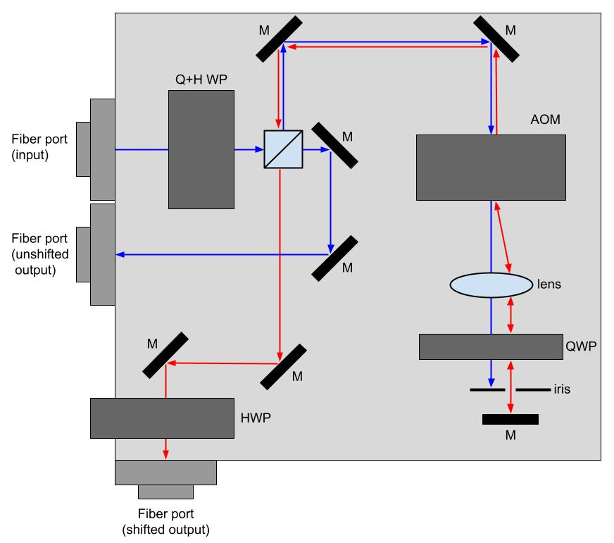

# double-pass-breadboard

The goal of this project is to realize stable, modular, and compact double pass acousto-optic modulator (AOM) systems for controlling the frequency and amplitude of laser light.  This project was directly inspired by [Ike Chuang's group](http://web.mit.edu/~cua/www/quanta/).

Breadboard versions are organized in directories labeled by the date (YY-MM) when the machined parts were *initially* ordered.  Each directory includes a README with a link to the corresponding STEP files (GitHub doesn't support the STEP file format) for the parts to be machined.

[2026-07-version](2026-07-version/2026-07_DP_breadboard_schematic.jpg) is the most recent.

## Schematic

## Polarizing Beam Splitter Handling

We use [Pattex Repair Extreme](https://www.pattexarabia.com/products/central-pdp.html/pattex-repair-extreme/SAP_0201OAP03X70.html) to secure the polarizing beam splitter (PBS) cubes to their mounts. 
- Note: use only a little dab of epoxy for a single corner and avoid the joint between the two halves of the cube. If epoxy contacts this joint, it will seep in over time, eventually ruining the PBS.

## Maximizing Double Pass Efficiency
* Adjust the beam path until it is level over the length of the breadboard and passes through the AOM aperture.
* Use a beam profiler to measure the beam far away (100cm) from the input fiber port, and minimize beam divergence using the three Zθ adjusters of the [Thorlabs PAF2 Series Collimators](https://www.thorlabs.com/newgrouppage9.cfm?objectgroup_id=2940). 
* Set the rough angle of the AOM with the rotating base mount so that it is orthogonal to the beam.
* Adjust the AOM's position using the kinematic mount to maximize diffraction efficiency at the desired AOM center drive frequency.  
* Measure the single pass efficiency and bandwidth.
* Place a plano-convex lens a focal length (f = 50 mm) away from the AOM with the convex side facing the AOM. Adjust the position of the plano-convex lens so the 0th order beam passes through the center of the lens.
* Put a flat mirror at the smallest beam width position, and adjust mirror to retro-reflect the beam. 
* Adjust the quarter wave plate and the flat mirror to maximize the light transmitted through the PBS. 
* Check the double pass efficiency and bandwidth before fiber coupling. 
* If the bandwidth is significantly smaller for the double pass than the single pass, adjust the distance between the AOM and lens to improve the bandwidth.
* Couple the light into the output fiber using the two mirrors before the output port. For detailed instructions on how to fiber couple with Thorlabs PAF2 Series collimators, see [Thorlabs manual](https://www.thorlabs.com/_sd.cfm?fileName=TTN132194-D02.pdf&partNumber=PAF2A-A10A) chapter 6.

## To-do
* Measure temperature stability.
* Test different mirror mounts.

